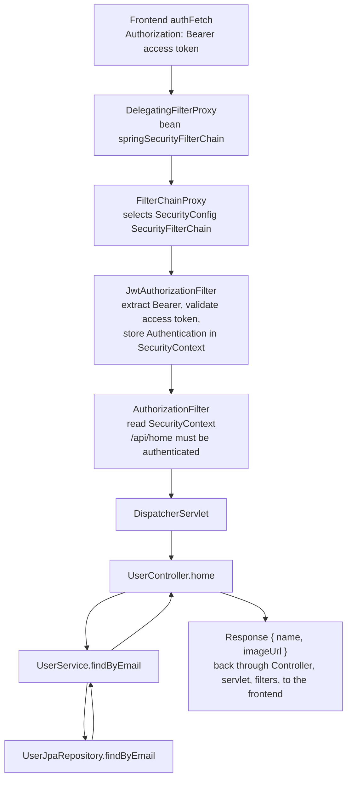
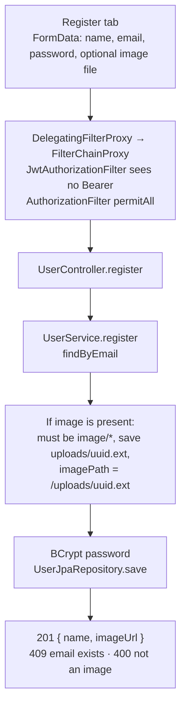
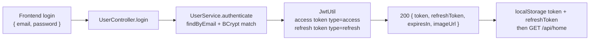
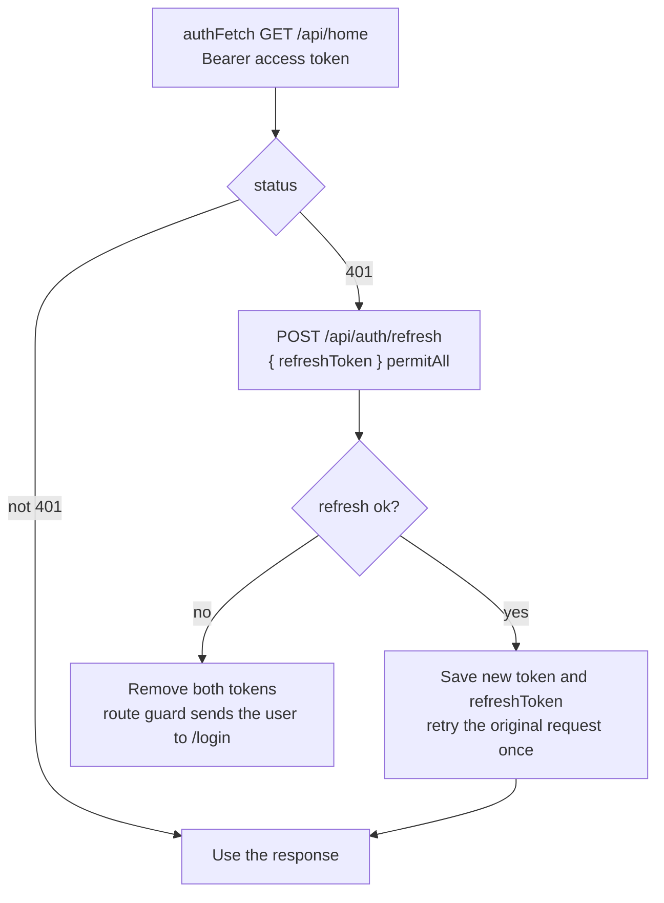

# User-App request flow

Frontend (`http://localhost:3000`) calls this app on `http://localhost:8081`.
Sessions are stateless. The only custom security filter is `JwtAuthorizationFilter`.
It extracts and validates the access token and stores the user in `SecurityContext`.
Spring Security's `AuthorizationFilter` then reads that object. This app does not assign roles.
Access is `permitAll` or `authenticated`.

## Protected request (`GET /api/home`)

1. The frontend sends `GET /api/home` with `Authorization: Bearer <access token>`.
2. The servlet container hits `DelegatingFilterProxy`, which delegates to the `springSecurityFilterChain` bean.
3. `FilterChainProxy` selects the `SecurityFilterChain` from `SecurityConfig` (stateless, CSRF off, CORS for `http://localhost:3000`).
4. `JwtAuthorizationFilter` runs before `UsernamePasswordAuthenticationFilter`:
   - Reads the `Authorization` header.
   - Strips the `Bearer ` prefix and calls `JwtUtil.email`, which accepts only a non-expired token whose `type` claim is `access`.
   - On success, stores `UsernamePasswordAuthenticationToken(email, null, empty authorities)` in `SecurityContextHolder`.
   - On a bad or expired token, logs the failure and leaves the context empty. The chain still continues.
5. `AuthorizationFilter` reads that `Authentication`. Rules in `SecurityConfig`:
   - `/api/auth/**` and `/h2-console/**` are `permitAll`.
   - `/api/home` is `authenticated`.
   - Every other request, including `GET /uploads/**`, is `permitAll`.
   - There is no role check. The authority list is empty. A missing principal on `/api/home` is a 401 from `HttpStatusEntryPoint`.
6. `DispatcherServlet` routes to `UserController.home`.
7. `UserService.findByEmail` calls `UserJpaRepository.findByEmail`.
8. The controller returns `{ name, imageUrl }`. The response goes back through the servlet and the filter chain to the frontend. The dashboard shows the name and, when `imageUrl` is set, ``.

## Register with image upload

`POST /api/auth/register` is `permitAll`. No JWT is required. The body is `multipart/form-data`.

`WebConfig` maps `/uploads/**` to `file:uploads/`, so the saved file is served as a static resource on the path returned as `imageUrl`.

## Login

`POST /api/auth/login` is JSON and `permitAll`.

The frontend stores both tokens, then loads `/api/home` and shows the name and profile photo.

## Refresh token and 401 retry

Access tokens expire (`jwt.access-expiration`). The refresh token is a separate JWT with `type=refresh` and is not accepted as a Bearer access token.

`UserController.refresh` calls `JwtUtil.emailFromRefresh`. That accepts only a non-expired `type=refresh` token, then `tokens()` issues a new access token and a new refresh token. One shared refresh call is reused if several requests get 401 together. Logout only clears `localStorage`; the server does not revoke tokens.
